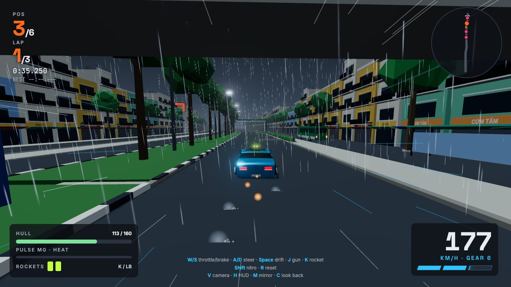
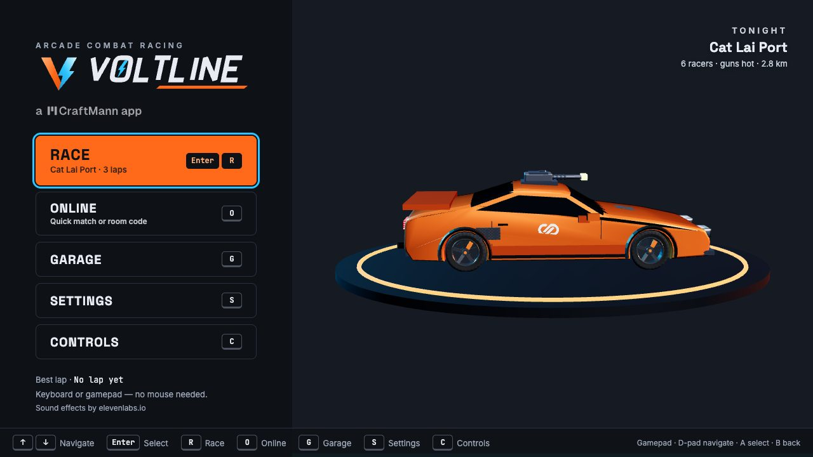
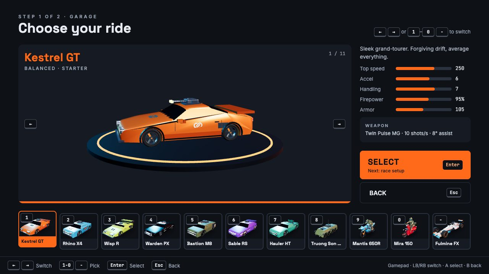
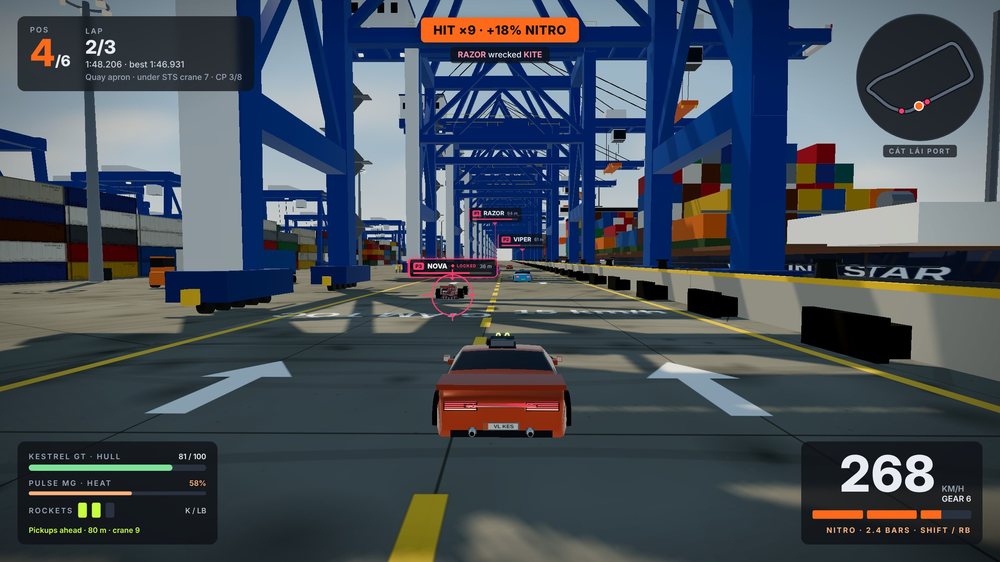
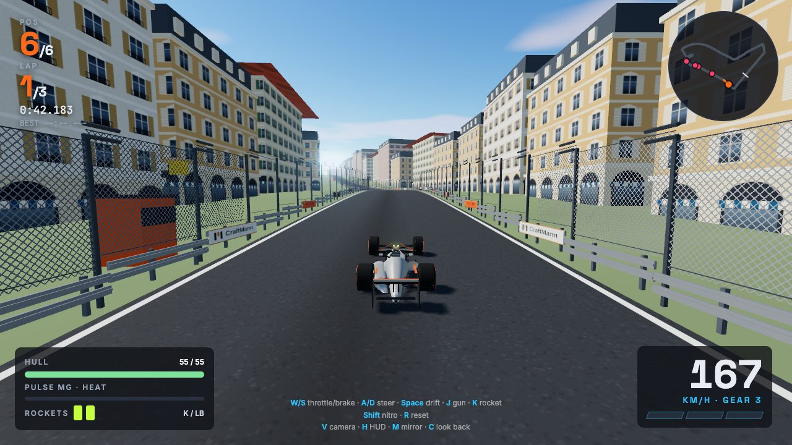
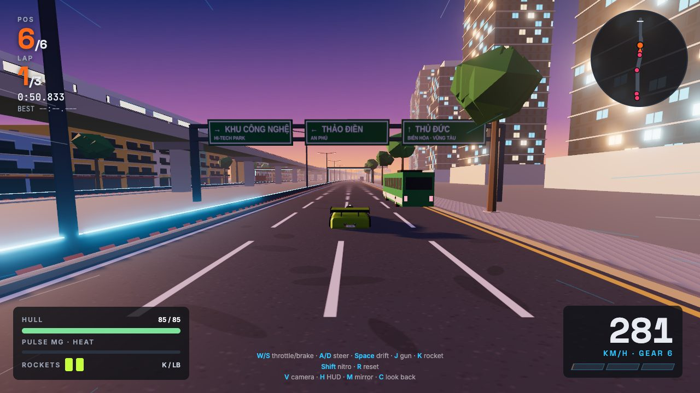
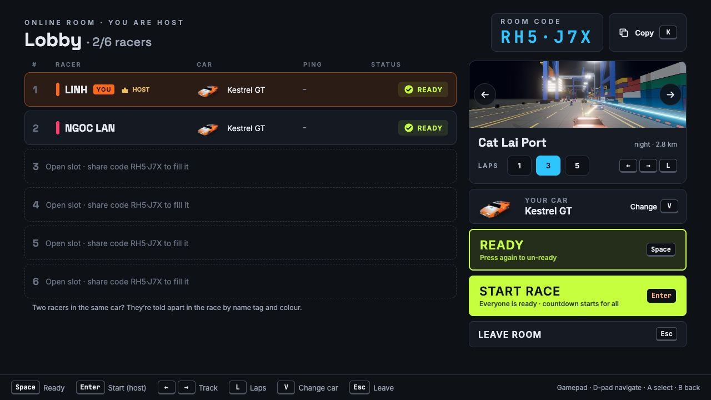
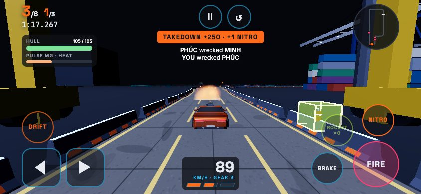

# VOLTLINE

**A browser 3D arcade combat racer.** Neon cities, a roof gun on every car, drift to charge nitro, shoot to clear the
line, finish first. Race five AI rivals offline, or race up to six players online. It runs in the browser with keyboard,
gamepad or touch (phones, landscape): nothing to install.

[](https://github.com/trung-tlt/Arcade-racing/actions/workflows/ci.yml)
[](LICENSE)

### [▶ Play it now: racing.craftmann.app](https://racing.craftmann.app)



## Features

- **11 vehicles, 5 maps**, from a balanced coupe to a heavy brawler, an open-wheel racer, scooters and motorbikes. Each
  has its own stats, hull, handling and roof gun.
- **Combat racing:** Pulse machine gun (aim assist, heat), homing rockets, repair and nitro pickups, damage states,
  wrecks and respawns. Drifting and takedowns charge the nitro.
- **Five hand-built maps:** a container port at night, a daytime HCMC boulevard, Hanoi at dusk with a bridge and
  underpass, a 4.8 km monsoon storm with puddles and a flooded dip, and a Monte-Carlo style harbour circuit.
- **Online multiplayer:** quick match, private rooms with a six-character code, a lobby, up to six racers, name tags,
  a rematch vote. The server is authoritative; the client predicts your own car, so steering stays instant.
- **Every number in data files** (`data/*.json`): cars, weapons, AI, tracks, audio. Tune the game without touching code.
- **Built for the web:** under 350 draw calls and 400k triangles, quality presets, a Low preset for phones, installable
  as a PWA, keyboard-and-gamepad menus.

## Screenshots

| | |
|---|---|
|  |  |
|  |  |
|  |  |

Phone, landscape, with the on-screen pads:



## Controls

| Action | Keyboard / mouse | Gamepad |
|---|---|---|
| Throttle / brake | W / S | RT / LT |
| Steer | A / D | Left stick |
| Drift | Space | X |
| Nitro | Shift | A |
| Fire Pulse MG | J or left mouse | RB |
| Fire rocket | K or right mouse | LB |
| Reset to track | R | Y |
| Pause | Esc | Start |
| Camera: chase / hood / cockpit | V | View |
| HUD: full / minimal / off | H | D-pad down |
| Rear-view mirror | M | |
| Look back (hold) | C | R3 |

Every menu works from the keyboard or a gamepad (arrows, Enter, Esc, hotkey chips). On phones the game is landscape only:
on-screen pads with auto-gas by default; tilt and swipe-wheel steering are in Settings. In an online race press **F8** for a
network diagnostics panel (ping, snapshot gaps, frame hitches, prediction corrections) and **F9** to copy its report.

## Maps

| Map | Setting | Notes |
|---|---|---|
| Cat Lai Port | Night | Container yard, port gate, truck queue, quay cranes, a shortcut lane |
| Cong Hoa Boulevard | Day | HCMC avenue with a median, landmarks and a U-turn |
| Hanoi Highway (Xa Lo Ha Noi) | Dusk | River bridge, underpass, metro viaduct, ambient traffic |
| Pham Van Dong Boulevard | Monsoon storm | 4.8 km, 2 laps: out on the car lanes, back on the motorbike lanes; heavy rain, wet grip, puddles, a flooded dip, lightning |
| Monte-Carlo Harbour | Day | 3.3 km, 3 laps: climb to the casino square, a tunnel with a no-fire zone, the harbour chicane, a five-light start |

## Run it locally

You need Node 20.19 or newer (22 recommended).

```bash
git clone https://github.com/trung-tlt/Arcade-racing.git
cd Arcade-racing
npm install
npm run dev          # http://localhost:5173
```

Other commands:

```bash
npm run build        # type-check + production build -> dist/
npm run preview      # serve the production build
npm test             # Vitest unit tests
npm run lint         # ESLint + Prettier check
npx playwright test  # browser tests (starts the dev server itself; needs a Chromium)
```

Playwright needs a Chromium: `npx playwright install chromium`, or `CHROMIUM_PATH=/path/to/chrome npx playwright test`.
The browser tests run serially because software WebGL is slow.

Dev URL parameters: `?quick=1` skips the menus and starts a race, `?mode=practice` starts solo with dummy targets,
`?car=<id>` and `?track=<id>` pick the car and the map (`cat_lai`, `cong_hoa`, `xa_lo_ha_noi`, `pham_van_dong`,
`monte_carlo`). In dev builds `window.__voltline` exposes test helpers (fast-forward, teleport, autopilot).

## Online multiplayer

The hosted game connects to a public race server. To play with friends: **ONLINE → Create room**, share the six-character
code, everybody picks a car and presses READY, the host starts. **Quick match** drops you into an open public room.

**How it works.** A Node server (`src/server/`) runs the full race simulation at 60 Hz and sends snapshots at 20 Hz over
WebSocket. The simulation (`src/sim/`) has no browser dependencies, so the same code runs in the client for prediction.
The client sends tick-stamped inputs and predicts its own car (reconciling smoothly with the server), draws the other cars
100 ms in the past by interpolation, and the server rewinds targets for shots (lag compensation, capped at 250 ms). More in
[docs/multiplayer-release-plan.md](docs/multiplayer-release-plan.md).

**Run your own server:**

```bash
npm run server:build
PORT=8080 npm run server:start       # then open http://localhost:5173/?server=ws://localhost:8080
```

For a deployed client set `VITE_RACE_SERVER=wss://your-server.example.com` at build time, and add that origin to
`connect-src` in the Content-Security-Policy (`amplify.yml`, `public/_headers`). Production setup (systemd, Caddy, limits,
rollback) is in [docs/server-deploy.md](docs/server-deploy.md), and the hardening notes are in
[docs/server-security.md](docs/server-security.md). `node scripts/loadtest.mjs` measures how many rooms a server holds.

## Project layout

```
src/
  main.ts            boot: load assets -> menus -> race
  core/              Game, Loop (60 Hz fixed step), Input, TouchInput, Assets, Settings, Data
  sim/               DOM-free race simulation shared by the client and the server (RaceSim, CombatSim, weather)
  shared/            network protocol (validation, constants)
  net/               online client: prediction, reconciliation, interpolation, clock sync, lobby client
  server/            the race server (WebSocket front end, rooms, limits, metrics)
  world/             tracks (spline -> road, barriers), environment, lighting, per-map dressing
  weather/           the monsoon storm: rain, puddles, spray, lightning, audio
  vehicle/           Car, CarPhysics (Rapier raycast vehicle), CarVisual, chase camera, nitro, turret
  combat/            Pulse MG, rockets, damage, pickups
  ai/                racing line, AI driver, AI gunner
  race/              laps, positions, standings, respawn
  fx/  audio/        particles, tracers, post-processing; the audio buses, engine and sound effects
  ui/                HUD, menu screens (hub, lobby, results), name tags, touch HUD, styles
public/assets/       models, textures, sound effects, music
data/                tuning and design data (see below)
tests/               Vitest unit tests (*.test.ts) and Playwright tests (*.spec.ts)
scripts/             collider baking, headless-vs-browser parity check, load test, screenshot capture
deploy/ docs/        server deployment files and the documentation
```

## Data-driven tuning

Every gameplay number lives in `data/`, not in TypeScript: `cars.json` (stats, colliders, wheel layout), `weapons.json`,
`handling.json` (driving model), `combat.json`, `ai.json`, `race.json`, `audio.json`, `lighting.json`, `touch.json`,
`online_ui.json` (online menu strings and rules) and one file per map in `tracks/` (spline, road, checkpoints, pickups,
dressing; the storm map also has a `weather` block).

## Performance

Target: 60 fps at 1080p on an Apple M1 or Intel Iris Xe, under 350 draw calls and 400k triangles, first load under 5 s.
Repeated props use `InstancedMesh`, particles, tracers and rockets are pooled, and there are at most four dynamic lights.
Quality presets (Low / Medium / High) are in Settings; phones default to Low.

## Deploying the game

The game is a static build (`dist/`). `amplify.yml` configures AWS Amplify Hosting (Node 22, `npm ci`, `npm run build`,
long-cache headers for `/assets/**`, `no-cache` for `index.html`, a Content-Security-Policy); `public/_headers` carries the
same headers for Cloudflare Pages or Netlify. Models, sounds and textures keep fixed names under `/assets/` and are cached
for a year: rename a file or add a `?v=` query to its URL when it changes.

## Contributing

Contributions are welcome: see [CONTRIBUTING.md](CONTRIBUTING.md) for setup, the ground rules and what a pull request needs.
Please read the [code of conduct](CODE_OF_CONDUCT.md), and report security problems privately as described in
[SECURITY.md](SECURITY.md).

## License and credits

Code and the original models, textures and music: [MIT](LICENSE), © 2026 Trung Tran. **Not covered by the MIT license:** the
CraftMann, CaptureMann and Emesoft brand marks, and the race-car sound effects by [ElevenLabs](https://elevenlabs.io/sound-effects/race-car)
(free-plan attribution: *Sound effects by elevenlabs.io*). Details in [NOTICE.md](NOTICE.md).

Built with [three.js](https://threejs.org), [Rapier](https://rapier.rs), [Vite](https://vite.dev), TypeScript and the Web
Audio API.
